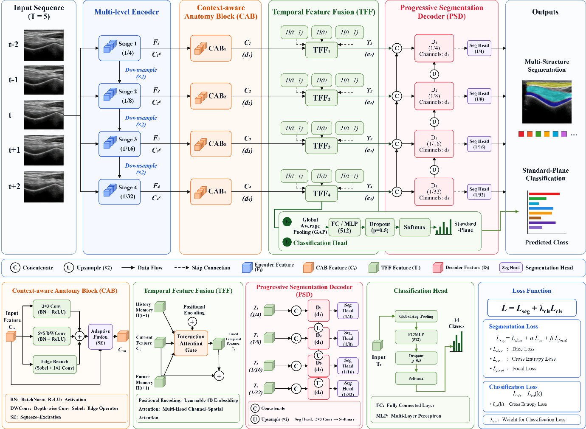

# CATF-MTNet

### Real-Time AI-Assisted Freehand Knee Ultrasound Using a Unified Multitask Deep Learning Framework for Standard-Plane Classification and Multi-Structure Segmentation

> [!IMPORTANT]
> **The source code, training and evaluation configurations, and pretrained model weights will be released after the paper is accepted.** Please watch this repository for updates.

## Overview

CATF-MTNet is a unified multitask deep learning framework for real-time AI-assisted freehand knee ultrasound. Given five consecutive ultrasound frames, the model simultaneously classifies 13 standard planes and segments 36 anatomical structures in the center frame.

The framework combines context-aware anatomical representation learning, temporal feature fusion, progressive multi-scale segmentation, and standard-plane classification in a single network. It was retrospectively developed and internally evaluated, prospectively validated at an external center, and further assessed in a prospective clinical study involving novice operators.

## Framework

  

CATF-MTNet contains four main components:

- **Multi-level encoder:** extracts hierarchical features from a five-frame sequence.
- **Context-aware Anatomy Block (CAB):** enhances anatomical features using multi-scale convolution, edge information, and adaptive fusion.
- **Temporal Feature Fusion (TFF):** integrates the current frame with historical and future context at multiple feature levels.
- **Multitask prediction:** a progressive decoder produces multi-structure segmentation, while a classification head predicts the standard plane.

## Study Cohorts

| Cohort | Design | Participants | Patients | Healthy controls |
| --- | --- | ---: | ---: | ---: |
| Internal dataset | Retrospective | 662 | 452 | 210 |
| External validation dataset | Prospective | 510 | 327 | 183 |
| Clinical evaluation | Prospective AI-assisted scanning study | 50 | — | — |

Each knee joint was assessed across **13 standard planes** encompassing **36 anatomical structures**. The clinical evaluation compared AI-assisted and unassisted scanning by three novice operators.

## Main Results

### External Validation

| Task / metric | Performance |
| --- | ---: |
| Standard-plane classification accuracy | 95.5% (95% CI, 95.3%–95.6%) |
| Mean segmentation Dice score | 0.941 (95% CI, 0.940–0.941) |
| Mean normalized surface distance (NSD) | 0.859 (95% CI, 0.858–0.860) |
| Throughput | 202.0 ± 0.7 predictions/s |

Performance remained consistently high at the individual plane and structure levels, with no significant differences between patients and healthy controls.

### Prospective Clinical Evaluation

AI assistance:

- reduced mean acquisition time by **57.9 seconds**;
- increased acquisition accuracy from **90.4% to 94.6%**;
- increased mean Dice score from **0.891 to 0.928**; and
- increased mean NSD from **0.825 to 0.854**.

All reported comparisons had **P ≤ 0.006**.

## Abstract

**Background:** Deep learning has the potential to reduce operator dependence in knee ultrasonography, but existing frameworks remain limited in supporting real-time multitask freehand scanning.

**Purpose:** To develop and prospectively validate a unified multitask deep learning framework for simultaneous standard-plane classification and multi-structure segmentation in real-time freehand knee ultrasound.

**Materials and Methods:** We enrolled 662 participants (452 patients and 210 healthy controls [HCs]) in a retrospective internal dataset and 510 participants (327 patients and 183 HCs) in a prospective external validation dataset. Each knee joint was assessed across 13 standard planes encompassing 36 anatomical structures. CATF-MTNet was developed using five consecutive frames as input to simultaneously perform 13-class standard-plane classification and 36-structure segmentation. Performance was evaluated using accuracy, F1 score, Dice score, and normalized surface distance (NSD), with comparisons between patient and HC groups, model ablation, and computational efficiency analyses. Finally, a prospective clinical evaluation was conducted in 50 participants examined by three novice operators to assess real-time AI-assisted versus unassisted scanning.

**Results:** In the external validation, CATF-MTNet achieved an overall classification accuracy of 95.5% (95% CI, 95.3%–95.6%), a mean segmentation Dice score of 0.941 (95% CI, 0.940–0.941), and an NSD of 0.859 (95% CI, 0.858–0.860). Performance remained consistently high at both the individual plane and structure levels, with no significant differences between patients and HCs. Computational efficiency analysis yielded a throughput of 202.0 ± 0.7 predictions per second, exceeding the real-time processing requirement. In the prospective clinical evaluation, AI assistance significantly reduced novice operators' mean acquisition time by 57.9 seconds and increased acquisition accuracy from 90.4% to 94.6%, mean Dice score from 0.891 to 0.928, and mean NSD from 0.825 to 0.854 (all P ≤ 0.006).

**Conclusion:** CATF-MTNet achieved robust performance for simultaneous standard-plane classification and multi-structure segmentation in real-time freehand knee ultrasound, effectively improving novice operator efficiency and accuracy.

## Code Availability

This repository currently serves as the project page for CATF-MTNet. The following resources are planned for public release after acceptance of the paper:

- model implementation;
- training and evaluation code;
- configuration files;
- pretrained model weights; and
- inference and reproducibility instructions.

## Citation

Citation information will be added when the paper metadata becomes publicly available.

## Intended Use

CATF-MTNet is a research prototype. It has not been cleared or approved for clinical diagnostic use.
